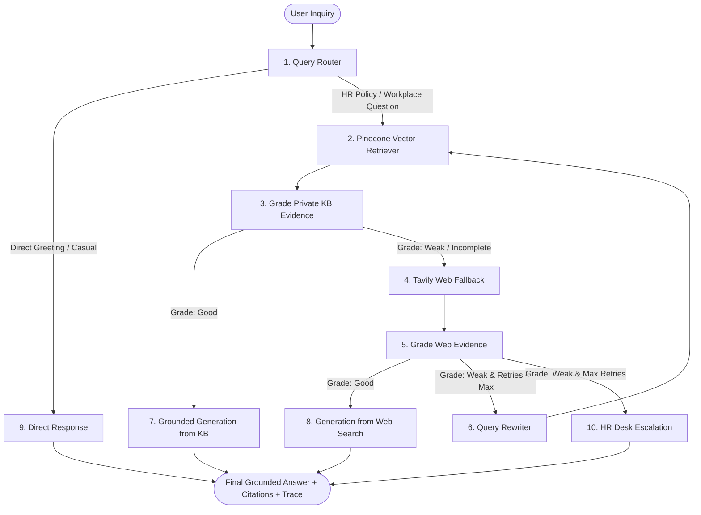

# 🏢 Enterprise HR Policy & Employee Support Agentic RAG Copilot

[](https://www.python.org/)
[](https://langchain-ai.github.io/langgraph/)
[](https://fastapi.tiangolo.com/)
[](https://www.pinecone.io/)
[](https://groq.com/)
[](LICENSE)

An enterprise-grade, production-ready **Forward Deployed Engineer (FDE)** Agentic Retrieval-Augmented Generation (RAG) assistant designed for Human Resources policy resolution, employee benefits inquiry, compliance auditing, and intelligent workplace support.

Unlike simple linear RAG pipelines that blindly retrieve top-$k$ chunks and feed them directly to an LLM, this system implements an **autonomous cyclical LangGraph state machine** that dynamically **routes queries**, **retrieves verified internal policies**, **grades evidence sufficiency**, **executes fallback web searches (Tavily)**, **rewrites queries**, and generates fully cited, hallucination-free answers with an SQLite audit trail.

---

## 🌟 Key Architecture & Capabilities



### 1. Agentic LangGraph State Machine
* **Query Router:** Employs structured output classification to differentiate between conversational pleasantries and complex HR policy inquiries.
* **Private-First Retrieval:** Queries high-dimension semantic embeddings from a serverless **Pinecone** vector database across official company HR handbooks.
* **Evidence Grader:** An LLM grading node inspects retrieved chunks against the original employee question to detect relevance, coverage gaps, or hallucinations.
* **Web Search Fallback:** When internal documentation lacks specific details, the copilot falls back to **Tavily** external search to provide industry standard benchmarks with clear source disclaimers.
* **Self-Correction & Query Rewriting:** Reformulates ambiguous employee questions into search-optimized queries and bounds execution to prevent infinite cycles.

### 2. Enterprise Policy Knowledge Base (`data/sample_kb/`)
Pre-loaded with 9 modular, industry-standard corporate policy documents:
* `01_leave_and_time_off_policy.md` (Annual leave accrual, sick leave, parental leave, carry-over rules)
* `02_remote_and_hybrid_work_policy.md` (Hybrid 3-day model, $800 home setup allowance, $60 internet stipend)
* `03_attendance_and_working_hours.md` (Core hours 10 AM-4 PM, flexi-window, overtime compensation)
* `04_payroll_compensation_and_reimbursement.md` (Last working day pay cycle, 401k/PF matching, expense claims)
* `05_employee_benefits_and_wellness.md` ($500,000 group medical cover, $600 wellness stipend, Modern Health EAP)
* `06_onboarding_and_offboarding_sop.md` (30-60-90 milestones, notice period guidelines, IT asset deprovisioning)
* `07_code_of_conduct_and_workplace_ethics.md` (POSH compliance, gifts, anti-moonlighting rules, whistleblower hotline)
* `08_employee_records_and_privacy_policy.md` (GDPR/PII data handling, retention rules, personnel file inspection)
* `09_hr_service_desk_and_request_forms.md` (Ticket priority SLAs, visa support letter forms, emergency numbers)

### 3. Production Stack
* **Backend:** FastAPI with modular routers, Pydantic schemas, and CORS security.
* **Vector Store:** Pinecone serverless index with namespace isolation (`langgraph-agentic-rag`).
* **Embeddings:** Free, local, fast `sentence-transformers/all-MiniLM-L6-v2` (384 dimensions) or OpenAI `text-embedding-3-small`.
* **Frontend:** Interactive dark-mode web dashboard featuring live node state animation, verified policy citations chips, execution trace timeline, and policy document drag-and-drop ingestion.
* **Auditability:** SQLite-backed audit logs capturing query text, source routes, timestamps, grading verdicts, and execution traces.

---

## 📂 Project Directory Structure

```text
HR_AGENT/
├── app/
│   ├── api/
│   │   ├── __init__.py
│   │   └── routes.py             # FastAPI REST endpoints (/chat, /upload, /audit, /health)
│   ├── core/
│   │   ├── __init__.py
│   │   └── config.py             # Pydantic BaseSettings loading from .env
│   ├── rag/
│   │   ├── __init__.py
│   │   ├── state.py              # AgentState, RouteDecision, EvidenceGrade schemas
│   │   ├── vectorstore.py        # Pinecone vector store and retriever manager
│   │   └── workflow.py           # 10-node LangGraph Agentic RAG cyclical graph
│   ├── services/
│   │   ├── __init__.py
│   │   ├── audit.py              # SQLite audit logging and metrics service
│   │   └── ingestion.py          # Document loader (PDF, DOCX, TXT, MD) & semantic chunker
│   └── main.py                   # FastAPI application initialization & static mounting
├── data/
│   └── sample_kb/                # 9 verified enterprise HR policy documents
├── static/
│   ├── css/
│   │   └── style.css             # Enterprise dark UI stylesheet
│   └── js/
│       └── app.js                # Frontend chat logic, visualizer animation & file uploader
├── templates/
│   └── index.html                # Main Enterprise HR Copilot Web Dashboard
├── ingest_sample_kb.py           # CLI script to chunk & upsert knowledge base to Pinecone
├── run.py                        # Uvicorn server runner with CLI options
├── run.bat                       # One-click Windows runner batch script
├── push.bat                      # Automated Git push script
├── run.ps1                       # PowerShell script runner
├── requirements.txt              # Production dependency specifications
├── .env.example                  # Environment variable configuration template
└── README.md                     # Comprehensive documentation
```

---

## 🚀 Quickstart Guide

### 1. Clone the Repository
```bash
git clone https://github.com/harmitprajapati2006/Enterprise-HR-Policy-Employee-Support-Agentic-RAG-Copilot.git
cd Enterprise-HR-Policy-Employee-Support-Agentic-RAG-Copilot
```

### 2. Set Up Virtual Environment
```bash
python -m venv venv

# Windows
.\venv\Scripts\activate

# Linux / macOS
source venv/bin/activate
```

### 3. Install Dependencies
```bash
pip install -r requirements.txt
```

### 4. Configure Environment Variables
Copy `.env.example` to `.env` and fill in your API credentials:
```bash
cp .env.example .env
```

```ini
GROQ_API_KEY="your_groq_api_key_here"
TAVILY_API_KEY="your_tavily_api_key_here"
PINECONE_API_KEY="your_pinecone_api_key_here"
PINECONE_INDEX_NAME="industry-agentic-rag-kb"
PINECONE_NAMESPACE="langgraph-agentic-rag"
GROQ_MODEL="openai/gpt-oss-20b"
EMBEDDING_MODEL="sentence-transformers/all-MiniLM-L6-v2"
```

### 5. Ingest Sample HR Policies into Pinecone
```bash
python ingest_sample_kb.py
```

### 6. Run the Enterprise Copilot Web Server
```bash
python run.py
```
Open [http://localhost:8000](http://localhost:8000) in your browser to interact with the copilot.

---

## 📡 REST API Reference

| Method | Endpoint | Description |
| :--- | :--- | :--- |
| `POST` | `/api/chat` | Submit employee query to Agentic RAG workflow and receive grounded answer, route badge, citations, and execution trace. |
| `POST` | `/api/upload` | Upload and chunk `.pdf`, `.docx`, `.md`, or `.txt` HR policy files and index them directly to Pinecone. |
| `GET` | `/api/health` | Service health status, model configurations, and Pinecone connection verification. |
| `GET` | `/api/audit` | Fetch recent execution traces and queries from SQLite audit database. |
| `GET` | `/api/stats` | Retrieve operational metrics (total inquiries, % resolved via internal KB vs web fallback). |
| `GET` | `/api/documents`| List all indexed sample policy files and user-uploaded documents. |

---

## 🧪 Testing with cURL / CLI

```bash
# Ask an HR inquiry via REST API
curl -X POST "http://localhost:8000/api/chat" \
     -H "Content-Type: application/json" \
     -d '{"question": "How many days of paid annual leave do I get and can I carry them over?"}'
```

---

## 🔒 Security & Enterprise Best Practices
* **Zero Hallucination Tolerance:** The generation node is strictly conditioned on retrieved and graded evidence.
* **Separation of Concerns:** Modular domain logic cleanly isolates state definitions, vector stores, graph orchestration, and API presentation.
* **Safe Secrets Management:** `.env` and local database files are included in `.gitignore` by default.
* **Audit Logging:** Every employee inquiry, retrieved context snippet, and agent decision path is logged for HR governance and compliance.

---

## 👤 Author
Developed with ❤️ by **Harmit Prajapati**  
GitHub: [@harmitprajapati2006](https://github.com/harmitprajapati2006)
